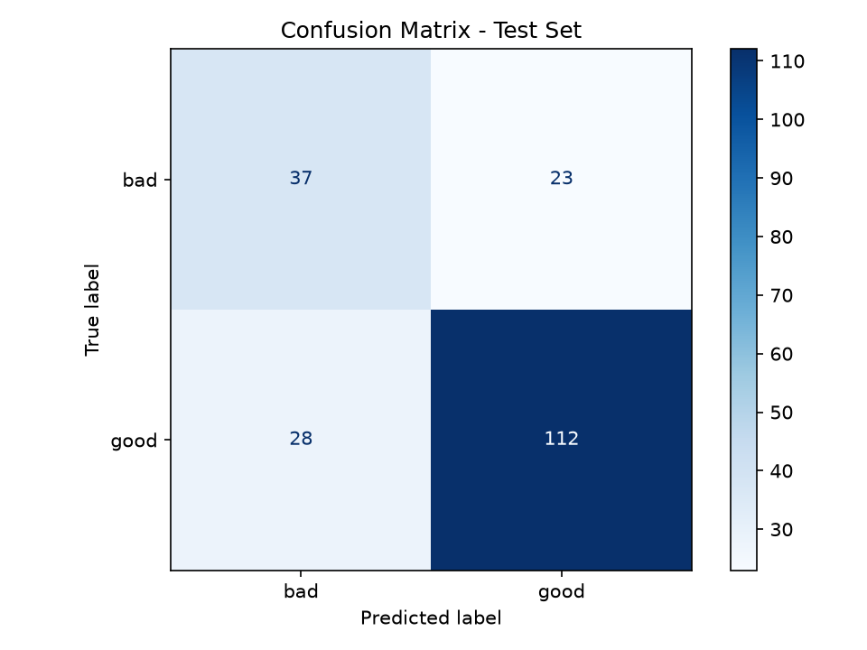
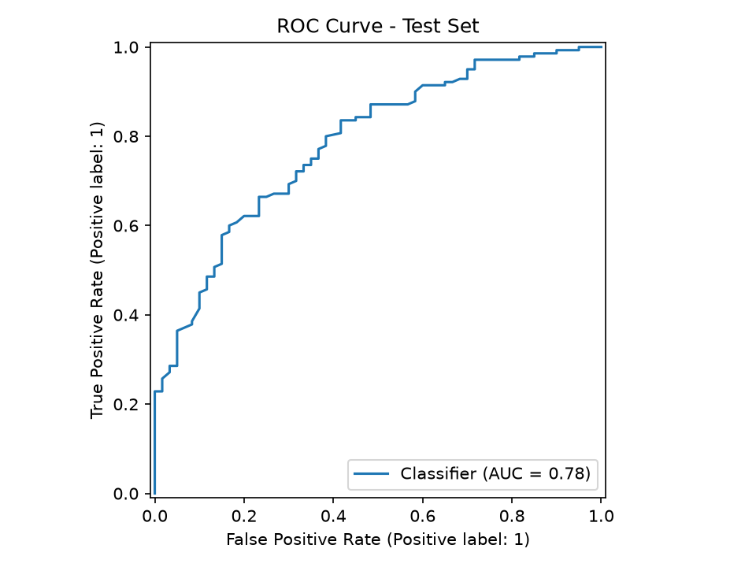

# Credit Scoring Model

Predicts an individual's creditworthiness (good / bad credit) using the German Credit dataset (UCI). Built as part of the CodeAlpha Machine Learning Internship (Task 1).

## Dataset

- **Source:** [German Credit Data (UCI)](https://archive.ics.uci.edu/dataset/144/statlog+german+credit+data)
- **Size:** 1,000 records, 20 features (checking account status, credit history, loan amount, duration, savings, employment, age, ...)
- **Target:** `1` = good credit (700 records), `0` = bad credit (300 records)

## Approach & Methodology

1. **Feature Engineering:**
   - `monthly_payment`: Estimated installment per month (`credit_amount / duration_months`)
   - `amount_per_age`: Loan amount relative to age (`credit_amount / age`)
   - `payment_to_installment`: Interaction between monthly payment and installment rate
   - Guarded against zero-division and missing edge cases.
2. **Preprocessing Pipeline:**
   - `StandardScaler` for numeric attributes.
   - `OneHotEncoder(handle_unknown="ignore")` for categorical attributes.
3. **Model Selection (Leakage-Free):**
   - Candidate models evaluated using **5-Fold Stratified Cross-Validation** strictly on the training set (`X_train`) to prevent test set snooping.
   - Handled class imbalance using `class_weight="balanced"`.
4. **Champion Model:**
   - **Random Forest Classifier** selected (CV ROC-AUC = 0.796 vs Logistic Regression CV ROC-AUC = 0.782).

## Evaluation Results

Evaluated on an independent, stratified 20% test set (200 samples: 140 good, 60 bad):

| Class | Precision | Recall | F1-Score | Support |
|-------|-----------|--------|----------|---------|
| Bad (0) | 0.57      | 0.62   | 0.59     | 60      |
| Good (1)| 0.83      | 0.80   | 0.81     | 140     |

| Metric | Value |
|---|---|
| **Accuracy** | **0.74 (74%)** |
| **Test ROC-AUC** | **0.784** |
| **5-Fold CV ROC-AUC** | **0.796 ± 0.058** |

### Visualizations & Model Evaluation Plots

The evaluation scripts automatically generate and save two key performance plots in the `models/` directory:

#### 1. Confusion Matrix


#### 2. ROC Curve


## Web Application

An interactive Streamlit application provides instant creditworthiness evaluation with an AI risk gauge, key financial metrics, and comprehensive input controls (including marital status and gender).


## Project Structure

```
CodeAlpha_Credit_Scoring/
├── app/            # Streamlit web application (app.py)
├── data/           # Raw and processed datasets (german.data, credit_data.csv)
├── models/         # Trained model pipeline and evaluation plots
│   ├── credit_scoring_model.pkl
│   ├── confusion_matrix.png
│   ├── roc_curve.png
│   └── app_screenshot.png
├── src/            # Core scripts: prepare_data, preprocessing, train, evaluate, predict
├── Credit_Scoring_Documentation.pdf # Comprehensive technical documentation
├── requirements.txt # Project dependencies (UTF-8)
└── README.md
```

## How to Run

```bash
# 1. Install dependencies
pip install -r requirements.txt

# 2. Prepare the dataset
python src/prepare_data.py

# 3. Train the model (with 5-Fold Cross Validation)
python src/train.py

# 4. Evaluate and generate plots
python src/evaluate.py

# 5. Launch the Streamlit web app
streamlit run app/app.py
```

## Tools & Libraries

- **Language:** Python 3.14
- **Libraries:** Pandas, Scikit-learn, Matplotlib, Streamlit, Joblib
